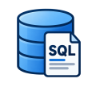

# Welcome to my SQL Portfolio Repository

## Overview

This repository features a collection of SQL projects that highlight my SQL skills.  Explore the SQL behind each project.

## SQL Projects

<table>
  <tr>
    <td align="center" width="50%">
      <h2>📆 Create a date table</h2>
      
Generates a date dimension table with weekend and U.S. federal holiday flags
 
      🔗 <a href="date_table/date_table.md">Documentation</a>
       
      MySQL, CTEs
    </td>
    <td align="center" width="50%">
    </td>
  </tr>  
</table>

 

## Contact

