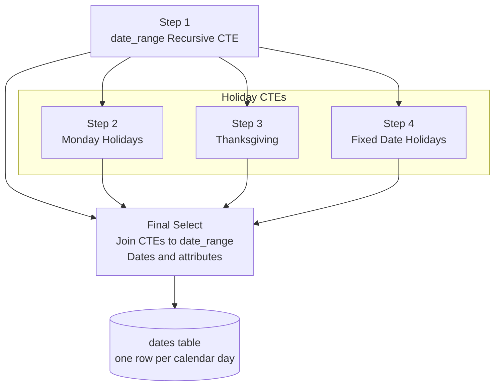

# :date: Date Dimension Table

This SQL project generates a date dimension table with date related attributes to support filtering, grouping, and sorting in reports and BI tools.  

## SQL Scripts

```text
sql/01_create_date_table.sql
sql/02_create_procedure.sql
```

### :black_circle: `01_create_date_table.sql` - creates a date dimension table

<div align="center">

### dates

| Column | Type | Nullable | Key/constraint | Description |
| --- | --- | ---: | --- | --- |
| `date_key` | `INT` | No | Primary Key | Unique key |
| `date` | `DATE` | No | Unique | Calendar date (YYYY-MM-DD) |
| `year` | `INT` | No | | Four digit calendar year |
| `quarter` | `INT` | Yes | | Calendar quarter, 1-4 |
| `month_name` | `VARCHAR(9)` | Yes | | Full month name for display |
| `month_sort` | `INT` | Yes | | Month number 1-12, use to sort month_name |
| `day_name` | `VARCHAR(9)` | Yes | | Full weekday name for dispay |
| `day_sort` | `INT` | Yes | | Day of week number, use to sort day_name |
| `is_weekend` | `TINYINT` | Yes | | Flag 1 = Saturday/Sunday, 0 = weekday |
| `is_holiday` | `TINYINT` | Yes | | Flag 1 = US holiday, 0 = not a holiday |

</div>

### :black_circle: `02_create_procedure.sql` - stored procedure adds dates to the `dates` table

#### Input parameters

<div align="center">

| Parameter | Type | Description |
| --- | --- | --- |
| `p_start_date` | `DATE` | start date of date range |
| `p_end_date` | `DATE` | end date of date range |

</div>

#### DB dependencies

<div align="center">

| Table | Operation | Purpose |
| --- | --- | --- |
| dates | INSERT | insert dates and attributes |

</div>

#### Process Flow



## Execution

```sql
CALL load_dates ('2018-01-01', '2026-12-31');
```

## Testing and Verification

```sql
SELECT COUNT(*) FROM dates;
```

| COUNT(*) |
|----------|
| 3287     |

```sql
DESC dates
```

| Field | Type | Null | Key | Default | Extra |
| --- | --- | --- | --- | --- | --- |
| date_key | int | NO | PRI | NULL | |
| date | date | NO | UNI | NULL | |
| year | int | NO | | NULL | |
| quarter | int | YES | | NULL | |
| month_name | varchar(9) | YES | | NULL | |
| month_sort | int | YES | | NULL | |
| day_name | varchar(9) | YES | | NULL | |
| day_sort | int | YES | | NULL | |
| is_weekend | tinyint | YES | | NULL | |
| is_holiday | tinyint | YES | | NULL | |

```sql
-- Check for NULL values
SELECT
  count(*)-count(date_key) missing_date_key,
  count(*)-count(date) missing_date,
  count(*)-count(year) missing_year,
  count(*)-count(quarter) missing_quarter,
  count(*)-count(month_name) missing_month_name,
  count(*)-count(month_sort) missing_month_sort,
  count(*)-count(day_name) missing_day_name,
  count(*)-count(day_sort) missing_day_sort,
  count(*)-count(is_weekend) missing_is_weekend,
  count(*)-count(is_holiday) missing_is_holiday
FROM dates;
```

| missing_date_key | missing_date | missing_year | missing_quarter | missing_month_name | missing_month_sort | missing_day_name | missing_day_sort | missing_is_weekend | missing_is_holiday |
| -- | -- | -- | -- | -- | -- | -- | -- | -- | -- |
| 0 | 0 | 0 | 0 | 0 | 0 | 0 | 0 | 0 | 0 |

```sql
SELECT * FROM dates;
```

Showing 5 of 3,287 rows

| date_key | date | year | quarter | month_name | month_sort | day_name | day_sort | is_weekend | is_holiday |
| --- | --- | --- | --- | --- | --- | --- | --- | --- | --- |
| 20180101 | 2018-01-01 | 2018 | 1 | January | 1 | Monday | 2 | 0 | 1 |
| 20180102 | 2018-01-02 | 2018 | 1 | January | 1 | Tuesday | 3 | 0 | 0 |
| 20180103 | 2018-01-03 | 2018 | 1 | January | 1 | Wednesday | 4 | 0 | 0 |
| 20180104 | 2018-01-04 | 2018 | 1 | January | 1 | Thursday | 5 | 0 | 0 |
| 20180105 | 2018-01-05 | 2018 | 1 | January | 1 | Friday | 6 | 0 | 0 |

[See full results](data/dates.csv)
